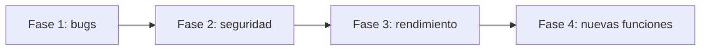

# Plan de implementación — Mejoras CENTINEL

Basado en la auditoría previa. Se divide en fases para que puedas revisar y aprobar cada una antes de seguir.

## Fase 1 — Correcciones críticas (bugs)

| # | Cambio | Archivos |
|---|--------|----------|
| 1.1 | Reportes PDF/CSV: usar `nombre_captura` en vez de "Desconocido" | [reportesController.js](file:///e:/SISTEMA%20VIGIA360/noc-backend/src/controllers/reportesController.js) |
| 1.2 | Guardar `camara_id` en `alertas_tacticas` para que el nombre de cámara sobreviva al refrescar | [engine.py](file:///e:/SISTEMA%20VIGIA360/noc-ai-worker/core/engine.py), [alertasController.js](file:///e:/SISTEMA%20VIGIA360/noc-backend/src/controllers/alertasController.js) |
| 1.3 | Alertas LPR: aceptar `foto` además de `foto_captura` para guardar la evidencia | [alertasController.js](file:///e:/SISTEMA%20VIGIA360/noc-backend/src/controllers/alertasController.js) |
| 1.4 | Quitar el log `Conectado a PostgreSQL` repetido en cada conexión del pool | [db.js](file:///e:/SISTEMA%20VIGIA360/noc-backend/src/db.js) |
| 1.5 | Quitar los `console.log [DEBUG-NOTIF]` | [notificationService.js](file:///e:/SISTEMA%20VIGIA360/noc-backend/src/services/notificationService.js) |

**Detalle de 1.2:** el worker ya conoce `cam_cfg["id"]`. Se agrega `camara_id` al payload y el `INSERT` lo guarda. Las alertas antiguas seguirán sin cámara (no hay forma de recuperarla).

**Verificación:** generar una alerta de prueba, refrescar el navegador y comprobar que conserva cámara y nombre. Descargar un reporte CSV/PDF y comprobar los nombres.

## Fase 2 — Seguridad (recomendado antes de producción)

| # | Cambio |
|---|--------|
| 2.1 | Mover `JWT_SECRET` al `.env`. Hoy hay un valor por defecto escrito en el código. |
| 2.2 | Proteger `POST /alertas`, `/vehiculos-capturados`, `/personas-capturadas` y `/notif/test`. Hoy no piden autenticación. Se usaría una clave compartida `WORKER_API_KEY` entre backend y worker. |
| 2.3 | Rotar las credenciales que quedaron expuestas en esta conversación: contraseña de Postgres, token de Telegram y contraseña de aplicación de Gmail. Es un paso manual tuyo. |
| 2.4 | Confirmar que `.env` esté en `.gitignore`. |
| 2.5 | Cambiar la contraseña por defecto `admin123`. |

> [!WARNING]
> El punto 2.2 requiere tocar backend y worker a la vez. Si se hace a medias, el worker dejará de poder enviar alertas.

## Fase 3 — Rendimiento y operación

| # | Cambio | Nota |
|---|--------|------|
| 3.1 | Telemetría real de CPU/RAM en el Dashboard, reemplazando `Math.random()` | Endpoint nuevo en el backend con `os`. La GPU solo si hay NVIDIA. |
| 3.2 | Script de limpieza de evidencias antiguas (`cleanup_old_evidence.js`) | Retención configurable, por defecto 30 días. |
| 3.3 | Soporte GPU en el worker | Es una instalación tuya: PyTorch con CUDA. Hoy corre en CPU. Solo aplica si tienes tarjeta NVIDIA. |

## Fase 4 — Funcionalidades nuevas (opcional, una por una)

1. Zonas de detección (polígonos) por cámara.
2. Varias fotos por sujeto para mejorar el reconocimiento facial.
3. Clips de video cortos como evidencia.
4. Búsqueda forense por color de ropa, cámara y hora.
5. Configuración de notificaciones desde la interfaz.

Cada una es un cambio grande. Se planificaría por separado.

## Orden propuesto

## Cómo se verifica cada fase
- Backend: reiniciar `npm run dev` y probar los endpoints afectados.
- Worker: reiniciar `python main.py` y revisar que no haya errores de arranque.
- Frontend: probar login, cámaras, alertas y reportes a mano.
- No hay pruebas automáticas en el proyecto, así que la verificación es manual.

## Preguntas abiertas
1. ¿Empiezo solo con la **Fase 1**, o con las Fases 1 y 2 juntas?
2. ¿Tienes tarjeta NVIDIA? Define si la Fase 3.3 aplica.
3. ¿Este sistema saldrá a producción o es una demo local? Cambia la prioridad de la Fase 2.
4. ¿Cuántos días de evidencias quieres conservar (punto 3.2)?
